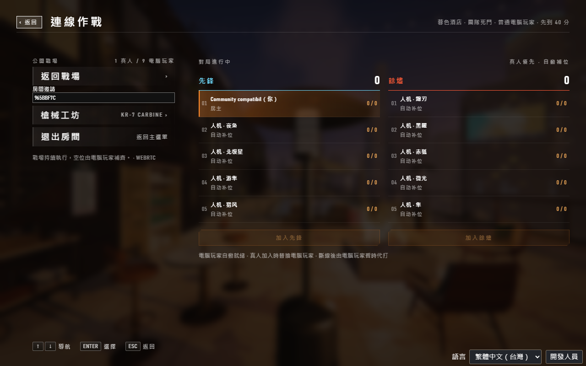

# 原版相容伺服器連線

本分支可在連線大廳選擇「原版相容伺服器」，以封存原版客戶端的公開協定連線並加入遊戲。原作者伺服器程式與 Git 歷史仍未取得；實作依據為 [2026-11-17 重新取得的客戶端原件](upstream/2026-11-17/README.md) 中的 `client/pvp.js`、`net.js`、`webrtc.js`、`lobby.js` 與 `api-config.js`。

## 使用方式

1. 啟動本分支客戶端，開啟「連線對戰 → 選擇對戰伺服器」。
2. 類型選「原版相容伺服器」，預填原服位址為 `https://cod.apikeygame.top:8008`。也可填入其他完整 HTTPS origin，不可含帳密、路徑或查詢參數。
3. 按「切換並重新載入」，輸入對戰呼號，選快速加入、建立房間或從大廳／代碼加入。
4. 離開房間後，可在相同選單選回「本地／社群伺服器」。切換會重新載入，確保帳號與武器從啟動時就使用正確模式。

也可使用 `http://127.0.0.1:48722/?server=https%3A%2F%2Fexample.org%3A8008&pvp=1`。`server` 參數明確啟用原版相容模式；移除該參數則使用既有本地模式。HTTP 僅允許 localhost／loopback 測試。

預設原服使用本機 API 轉送入口，套用此修正後需要重啟 `npm start`／`Start.cmd` 或可攜版啟動器，再重新載入遊戲。瀏覽器只向自己的 localhost 服務讀取房間列表、設定及交換 SDP，實際 WebRTC DataChannel 直接連到原服。

## 武器限制

| 已儲存的 Shop 型號 | 原版相容模式實際使用 |
| --- | --- |
| G-Bull (`gbull`) | STRIX 9 (`pistol`) |
| Chin-Gi (`chingi`) | VESPER 9 (`smg`) |
| Lin-Bei (`linbei`) | M12 (`shotgun`) |

KR-7 (`ar`) 保持原樣。限制從頁面啟動套用，包含單人訓練、槍匠、第一人稱／世界模型、武器定義及裝備封包。Shop 模型不下載、不掛載，型號選單停用；重生、切副武器、加入失敗與自動重連也不會解除限制。封包層將三個 Shop ID 轉回同類原版 ID，接收快照時僅接受原版四個索引 `ar/smg/shotgun/pistol`。原本的型號偏好不會被覆寫，回到本地模式即可恢復。

三把原版主武器為 KR-7、VESPER、M12，另有 STRIX 9 副武器。伺服器仍決定實際武器可用性及權威數值；本分支不會替遠端伺服器核發解鎖資格。

## 連線與帳號

- 原版相容模式不開啟本地 Vault、不要求本地 admission ticket，不呼叫本地 `/api/auth/*`、`/api/career`、`/api/invite` 或同步本地專服戰績。握手保留原版名稱、快速加入／公開開房、房間與續接欄位；本地 ticket、profile 憑證不會送至遠端。
- WebRTC SDP POST 不含 `Authorization: Bearer undefined` 或本地票券；輸入、快照、續接及離房流程共用。預設原服由轉送入口取得設定後直接選用已驗證的 WebRTC 路徑，避免等待原版 WebTransport 的失敗備援；其他相容伺服器仍保留原有傳輸選擇。
- 對方需要提供原版 `/api/config`、`/api/rooms/events`，以及宣告的 WebRTC SDP／WebTransport 服務。WebRTC 使用 `gh-pvp-v1` 的 `reliable`、`state` DataChannel；原版二進位協定與裝備索引保持一致。
- 預設原服的 `/api/config` 對 localhost Origin 回覆 `403 origin not allowed`；同一已登入 Edge 的 SSE 請求也回報 `MissingAllowOriginHeader`。原版 Toy Origin 則得到 HTTP 200。因此 `server/original-gateway.mjs` 只轉送固定原服的 config、health、rooms/events、rtc 與 rtc/offer，並使用原版 Toy Origin；不接受任意目的主機、查詢參數、Cookie 或本地 Authorization。
- 該端點的一般 SNI TLS 握手會被重設；省略 SNI 路由擴充後可正常建立 HTTP/2。轉送入口仍強制驗證 Node 信任鏈，並以 `tls.checkServerIdentity` 核對原本的 `cod.apikeygame.top`，沒有停用憑證驗證。SDP 限制 64 KiB、連線數上限 16；取消 SSE 時會關閉上游串流。
- 其他相容伺服器仍直接跨來源連線，需要它們允許客戶端 Origin 的 CORS。既有 TLS 信任與信令 Origin 校驗保留；沒有把這個固定原服入口擴充成任意代理。
- 相容模式不套用本地專服的武器擊殺解鎖規則、不顯示本地排行榜，也不把遠端擊殺／結算記入本地帳號的競技進度。原站 Toy 身分、雲檔與排行榜整合沒有重新接入。

## Toy 身分的差異

已登入的原版平台頁可透過 Toy SDK 讀取暱稱並同步成長雲檔。封存原版的 `pvp.js` 確實先呼叫 `toyMenus.authorize()`，但 `/api/config` 與 SDP 使用 `credentials: "omit"`，hello 只有名稱、房間及續接等欄位，沒有 B 站 Cookie、Toy OpenID 或存檔。本機客戶端使用自訂呼號，並維持匿名、不同步原站雲檔的界線。

本次原服實測使用全新、未登入 B 站的瀏覽器設定檔，能完成 welcome、加入及接收原服快照。這直接驗證了目前原服允許匿名握手；原版登入成功與先前匿名失敗，不能單憑時間不同的兩次測試判定為帳號驗證差異。

## 驗證與限制

`npm test` 包含 URL／origin 校驗、原版模式啟動前的型號回退與偏好保留、Shop 模型停用、送出封包的武器與憑證限制、快照索引相容性、固定轉送路徑、SDP 限制、取消 SSE、憑證不轉送及遠端訊令不能更換 Origin 等測試。

```sh
python server/check_original_compatible.py
```

上述瀏覽器檢查需要 Python Playwright 與 Edge（可用 `GH_BROWSER` 指定 Chromium 執行檔），自行啟停兩個專用 loopback 測試服務與記憶體資料庫。它使用實際瀏覽器 WebRTC，檢查 UI 加入、匿名 SDP／hello、移動 ACK、射擊／換彈、保留席位重連、三種武器回退、偏好保留，以及從切換選單返回本地模式後的帳號／Shop 對戰。設定 `GH_COMPAT_CAPTURES` 可保存選單畫面。

`server/fixtures/original-server.mjs` 是依封存原版客戶端協定撰寫的本機測試替身，模擬仍沿用本分支 `Room`。上述測試結果只證明本機協定與客戶端流程。

2026-11-17 更新後本地驗證：`npm test` 170 項通過；上述 Edge／實際 WebRTC 檢查通過，包含兩次 welcome 的同席位續接、輸入 ACK 12，以及原版模式 → 本地帳號／G-Bull 模式的完整切換。專服打包清單包含新增 gateway，並以獨立暫存目錄載入其模組，確認依賴完整。

另有明確啟用才會執行的原服檢查。先啟動本分支，再在 PowerShell 執行：

```powershell
$env:GH_ORIGINAL_LIVE = "1"
python server/check_original_live.py
```

這個檢查會以匿名測試呼號建立一間短暫公開房間，檢查實際 WebRTC 握手、移動 ACK、原版副武器及離房。`GH_DEV_PORT` 可選擇測試客戶端埠，`GH_LIVE_CAPTURES` 指定證據目錄。它不需要 B 站帳號或 `.ghsave`，不射擊其他玩家，結束時會離房。公網的其他 NAT／TURN 環境、實體雙機、WebTransport 成功路徑及原站 Toy 雲檔仍未涵蓋。

預設另觀察 60 秒並保存逐秒網路數值，結束前要求收到新的權威快照。`GH_LIVE_SECONDS` 可設為 1–300 秒，`GH_LIVE_HEADED=1` 顯示獨立的測試瀏覽器。是否曾重連以 `noReconnects` 及連線次數另外報告；加入／離房成功不等於整段沒有停頓。[後續延遲調查與恢復策略](original-network-recovery.md)

2026-11-17 19:49–19:50（Asia/Taipei）原服實測通過：本分支在 `http://127.0.0.1:48724` 的全新匿名 Edge 設定檔中列出 3 間公開房間，完成 WebRTC 加入，收到 112 個快照、移動 ACK 30，並以 STRIX 9／15 發回退副武器後正常離房。瀏覽器的跨站 HTTP 請求與頁面錯誤皆為 0。這是短時連線與操作檢查，沒有宣稱長時間穩定性或遊戲效能。[完整去識別實測紀錄](original-server-2026-11-17.json)



## English

Select an original-compatible server in the multiplayer lobby, enter its HTTPS origin and reload. The URL's `server` parameter fixes the mode for the page lifetime. The client uses the archived anonymous protocol and never sends local admission/account credentials. Shop models, stats and equip IDs fall back to their original family equivalents; saved model preferences survive the switch. Local account progression and leaderboards are isolated from remote matches.

The default original server rejects localhost origins. A fixed-origin local gateway now relays config, room SSE and SDP over HTTP/2, retaining certificate-chain and exact-host verification while accommodating that endpoint's SNI reset. It forwards no local credentials and selects the working WebRTC path; game data goes directly between the browser and the original server. Other compatible servers retain direct transport selection and require their own CORS support. Restart the local server after updating.

The Toy SDK provides the original platform's nickname and cloud saves. The original config/SDP requests omit credentials; this fork was also tested against the real server using a fresh anonymous browser profile. Local fixture checks and the opt-in `GH_ORIGINAL_LIVE=1` production smoke test remain separate; the latter creates and leaves a short anonymous public room.

The November 17 live run passed: real WebRTC join, 112 snapshots, movement ACK 30, original STRIX 9 with 15 rounds, and normal leave. There were no browser cross-origin HTTP requests or page errors. This establishes a short real-server smoke test, not long-term stability, performance or broad NAT/TURN acceptance.

The opt-in live check now observes 60 seconds by default (`GH_LIVE_SECONDS`, 1–300), requires fresh snapshots at the end, and separately reports reconnects. `GH_LIVE_HEADED=1` shows its independent browser. See the [subsequent recovery investigation](original-network-recovery.md) for bounded stall recovery and unresolved original-server latency.

## v60115 公開目錄與 Toy 身分

大廳可以獨立選擇 v60115。此模式從固定正式端點讀取公開配置和版本化地圖目錄，保留正常 TLS 驗證。預覽提供原站入口。原站的封存客戶端在加入前要求 B 站 Toy 授權，本社群客戶端目前沒有獲准使用的 Toy 身分提供者。

新版封包驗證依照 2026-11-25 客戶端封存。hello 的地圖／模式選擇、Toy UID、武器協定 2、shot ACK 與特效資料報能力分開處理。房間的地圖版本與模式適配器可和公開目錄核對。WebRTC 與同一批准 origin 的 WebSocket 可在本機替身中切換及續接，且與社群登入獨立。既有 v49221 仍使用上文的路徑。

2026-11-25 16:57（Asia/Taipei）正式公開 GET 驗證得到 WebRTC 優先、WebSocket 可用，以及 `hotel@2`、`shipment@3`、`sublevel-07@4` 三張 TDM 地圖。正式目錄未列灰港合作地圖或模式。實際 Toy 授權入房、正式服務上的資料通道與灰港資源仍待驗證。參閱 [正式原站](https://www.bilibili.com/toy/golden-hour/index.html)。
