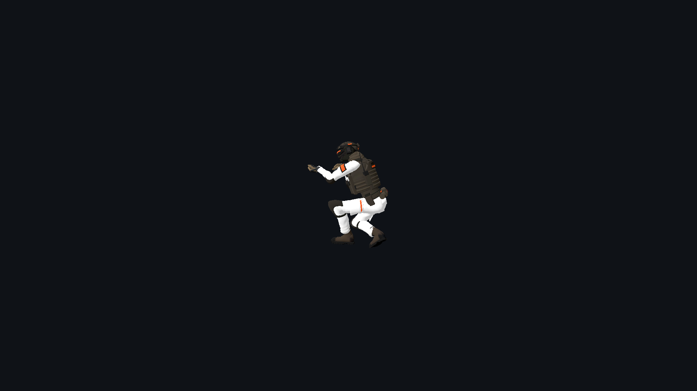
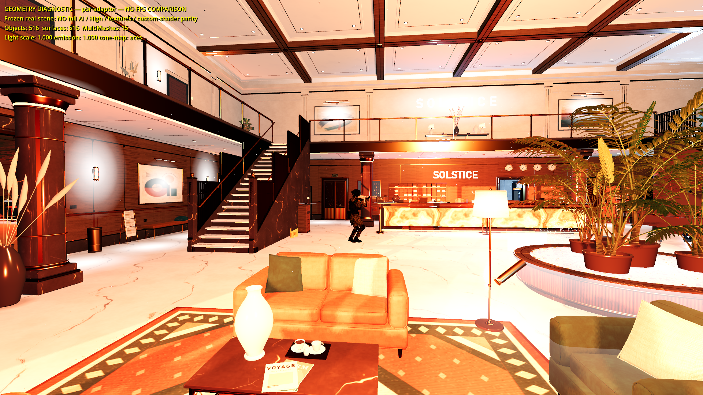
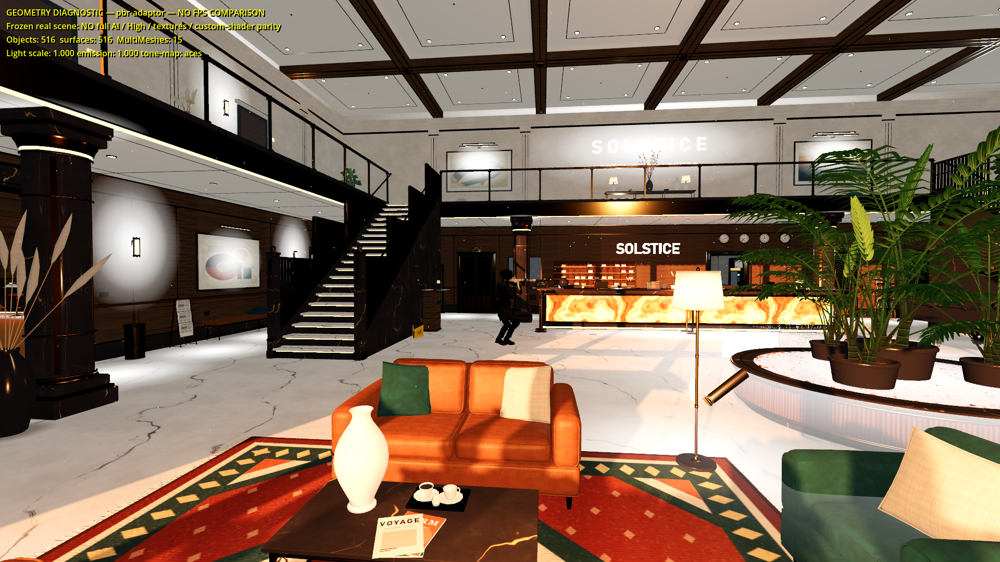

# Browser render performance: staged work

## Scope and acceptance

1920x1080 drawing buffer, DPR 1, render scale 100%, High effects retained,
reflections capped at 30 Hz. Original hardware-accelerated Edge browser only.
Full native tactical AI, perception, navigation, death/ragdoll, grenade and K9
paths remain enabled under the fixed full-AI player/opponent scenario.

Target: stable 60 rendered FPS or 1% low above 45 FPS. For the alternative gate,
1% low is 1000 divided by the arithmetic mean of the slowest ceil(N * 0.01)
submitted-frame intervals, measured across the complete active fixed scenario.
Report reciprocal P99 separately; do not call it the same metric. Also retain
warm-window statistics, every long frame, render vs logical rate and dropped
simulation time. A target claim requires three clean complete runs, correct
native-AI coverage and logical outputs, without profiler/timer/OS-sampler load.
Frame intervals measure browser render submissions, not physical display presents.

## Stage 0: checked-in baseline

The prior local iteration is now preserved on this work branch before new
experiments. It includes bounded solo fixed-60 logical simulation separated
from a capped render gate, raycast broadphase and boolean queries, particle
upload accounting, one scene matrix snapshot per rendered frame, correct
preparation fences, body-fade material preparation, full-AI benchmark modes,
and an optional operator-decoding Worker. PvP retains Engine prediction.

The existing runtime was revalidated: npm test, 88/88 passed on 2026-11-16.
Earlier hardware evidence (external workspace outputs/browser-next/report.html)
showed 59.48-59.49 logical Hz and 42.43-43.35 rendered FPS in native-loop mode.
The target is not achieved. The isolated fade correction removed a first-fade
stall (412.5 -> 16.5 ms median at tick 658) but did not eliminate long frames.
Worker startup had no consistent total-ready improvement and remains opt-in.

Remote main had only an additional README commit, which this branch retains.
No desktop packaging or release is part of this work.

## Next investigation

Separate agents own scene submission, shadows and reflections. Astra owns
threading feasibility and independent review. Root serializes hardware GPU
work, integrates only evidenced candidates, verifies fixed-AI equivalence and
pushes one commit for every completed stage. Existing static batching and the
scene matrix snapshot must be accounted for. The rejected matrix-cache guard
is not part of this baseline.

## Stage 1: observe before changing render work

The explicit developer observer is documented in [render-diagnostics.md](render-diagnostics.md).
It separates CPU inclusive/self spans, sparse per-pass GPU-clock intervals,
submission counters, worker-internal samples and trace thread evidence. Normal
startup does not load it. Actual hardware full-AI replay and context restoration
passed; the integrated suite passed 101/101. Frozen summary evidence is in
[stage1-observation.json](evidence/stage1-observation.json).

A fresh uninstrumented full-native-AI baseline measured 43.54 FPS, P95/P99
35.8/45.2 ms and 1% low 15.44 FPS. All eight logical exports matched the prior
native baseline. The goal is not achieved. Separate diagnostic profiling found
QX.getParameters and program selection to be large CPU costs. A marked 20.017 s
trace pinned the game CrRendererMain by PID/TID and recorded 19.206 s of thread
CPU clock. This trace has overhead; it is not an uninstrumented utilization
benchmark. Its longest two main-thread tasks were WebAudio deferred cleanup,
58.25/54.43 ms, which warrants a separate audio-lifecycle investigation.

FX light-layout isolation and shadow material variants remain isolated candidates
at this stage. Counter A/B preserved logical exports and reduced light-triggered
parameter rebuilds from 133.20 to 0.81 per rendered frame. Neither this counter
result nor a single FPS pilot establishes target acceptance.

Reproduction uses the existing portable client build (Play.cmd) and installed
Python Playwright + Edge. No new runtime dependencies were introduced:

```powershell
$env:GH_BENCH_OUT = 'D:/Golden-Hour/work/browser-render-next/reproduction'
# Only if Playwright is supplied outside Python site-packages:
$env:GH_BENCH_DEPS = 'D:/Golden-Hour/work/testdeps'
python scripts/performance/run_browser.py --client D:/Golden-Hour/work/browser-next/candidate-combined --name unique-primary --quality high --native-loop
python scripts/performance/analyze_browser.py $env:GH_BENCH_OUT/unique-primary.json
# Copy current game/ into a portable candidate before testing new code.
# Add --render-dev for developer observation, --trace-threads for a separate
# 20-second thread trace. Those runs never count toward the FPS acceptance gate.
```

The raw evidence name must be unique; the runner refuses overwrites. A trace
can be hundreds of MB. Keep raw profiles/trace/isolated stores outside Git.

## Stage 2: remove repeated light layouts and shadow variants

World, reflection and FX continue their full light collection and view updates.
Only the main world's FX layer masks 4/8 use a separate light-layout bank, so
an empty FX pass no longer invalidates the world's lit-material parameters.
Real light additions/removals still change versions; same-count position/color
changes still update uniforms. Scene/depth ownership and transmission targets
remain with the existing render state.

Default shadow depth/distance materials now keep bounded slots for live geometry
feature combinations. Morph, cutout, clipping, displacement, batched and custom
material paths retain legacy behavior. Seeing any custom before/after shadow
callback permanently disables both slot banks for that shadow-map instance,
preserving mutations of legacy shared depth materials for subsequent casters.
Disposal releases slots before renderer properties/programs; context restoration
creates a new instance. High size, filtering, refresh, casters and order remain.

The actual owning renderer tests and complete suite passed **114/114**. Independent
review checked shared uniform references, dynamic lights, nested ownership and
the callback side effect (found, reproduced, then fixed). Eight logical exports
remain exactly equal to the baseline under full native AI.

A fresh uninstrumented AB pair at the frozen source measured:

| Complete active scenario | Baseline | Stage 2 |
| --- | ---: | ---: |
| Rendered FPS | 38.18 | 46.05 |
| 1% low FPS (slowest-tail mean) | 12.92 | 15.61 |
| P95 / P99 ms | 40.4 / 50.8 | 34.0 / 42.3 |
| >50 ms intervals / minute | 23.59 | 9.91 |
| Maximum interval ms | 353.5 | 277.1 |

An earlier baseline/pilot measured 43.54/49.16 FPS. This variation is retained;
one fresh AB pair plus pilots does not establish statistical target acceptance.
All long frames remain in the complete window. The 60 FPS / 1% low >45 goal is
**still unmet**. Detailed source hashes and measurements are in
[stage2-render.json](evidence/stage2-render.json).

The next isolated candidates are proven-planar individual fractured panes,
conservative reflected-batch culling and private audio-node reuse. They are not
included in this stage's runtime change. Geometry proof alone does not establish
equivalent DoubleSide/FlipSide lighting; use a frozen two-sided GPU pixel oracle
before accepting single-pass panes. Audio PCM equivalence and cleanup/tail-frame
measurements are separate gates. Empty-pool draw shortcuts were rejected as a
low-priority opportunity with callback/ring semantics costs and no measured gain.

## Stage 3: single-pass proven-planar fractured panes

Only an individual fractured pane whose finite nondegenerate triangles are
exactly coplanar with consistent winding uses the cached single-pass material.
Deleting cells cannot invalidate that proof. Intact glass instances, shards,
thick glass and rejected panes retain their original two-pass behavior. The
clone shares shader hooks, follows environment rebuilds, and is prepared with
a temporary non-instanced quad behind the existing readiness/draw fence.

Actual hotel geometry passed the predicate for 113/124 panes; the other 11 keep
their previous rendering. This is geometry eligibility, not a claim that all
those panes are fractured or visible in a frame.

The full native-AI scenario retained all eight logical exports. Three standing
eligible panes were tested from both faces, frontal and oblique: **12 real GPU
views, exact AA/BB/AB pixel equality**, nonblack images, positive hidden-pane ROI
contribution, and native selected-pane submissions reduced from two to one.
The oracle runs synchronously after gameplay and has no FPS claim. Earlier QA
versions incorrectly replayed raw GL draw-buffer state; those failures were
retained. The current controlled QA uses native renderer.resetState(), restores
game/renderer controls and exposure history, and requires a normal subsequent
render with zero GL errors. It does not claim arbitrary third-party GL bindings
are restored byte-for-byte. See `scripts/performance/fracture_oracle.js`.

An uninstrumented full run measured **50.72 FPS**, 1% low **17.01 FPS**, P95/P99
**30.4/38.6 ms**, >50ms **6.95/min**, maximum **261.3 ms**. The complete window
retains first use and every long interval. Warm-only results are supplemental.
The prior stage-2 fresh candidate was 46.05 FPS; these are isolated runs with
known machine/run variation, not a statistical target claim. The **target is
still unmet**. Functional High quality/scale changes, real context recovery,
resume and equipment switching passed. Source and raw-derived summaries:
[stage3-glass.json](evidence/stage3-glass.json).

Reproduce the visual oracle separately from acceptance runs:

```powershell
python scripts/performance/run_browser.py --client PATH_TO_CURRENT_PORTABLE_CLIENT --name unique-glass-oracle --quality high --native-loop --fracture-oracle
node --test server/fracture-oracle.test.mjs
```

Further evidence narrowed priorities: repeated identical skeleton palette work
was about 0.139 ms/frame; baked geometry has 100 meshes and 87 truly different
materials, with zero exact duplicate candidates; reflection tightening removed
only five submissions with no consistent CPU gain. Those changes were rejected.
Audio-node reuse passed PCM oracles but has no consistent tail-frame benefit in
the first primary run and remains isolated. A new candidate investigates only
opaque physics chairs with shared geometry/materials; it is not in this stage.

## Stage 4: screen chair submissions and audio first use

The startup-only chair instance prototype retained the 42 native physics bodies,
colliders and interaction objects. Hardware eligibility was 118 source meshes
into 12 groups; 106 fewer submissions/pass is a structural ceiling. One clean
complete native-AI pilot measured 48.91 FPS, 1% low 15.30 FPS, P95/P99
32.8/41.6 ms and 12.87 intervals >50 ms/min. All eight logical exports matched
stage 3. This isolated run does not establish a statistical regression, and it
provides no evidence of a net performance improvement. The prototype remains
isolated and is not enabled in the product.

A separate observer/profile run measured chair maintenance at 0.312 ms/render
(2,648 calls). Its first fixed-camera oracle had exact AA/BB/AB pixels and
28 native versus 6 instance submissions, but hiding chairs changed zero pixels:
they were occluded, so the oracle correctly skipped acceptance. A subsequent
focused dining-chair view proved 415,396 pixels of chair contribution. AA and BB
were stable; AB differed at 1,039/2,073,600 pixels: 1,024 had maximum channel delta
1, and the remaining 15 reached delta14. No GL errors occurred, including the
normal subsequent render. The strict comparison did not pass; no tolerance was
relaxed. Floating-point transform grouping/rasterization is a possible cause,
not an established diagnosis. No broad visual-equivalence claim is made.

Bounded audio cue diagnostics recorded 36 first-buffer events with zero overflow
in the complete full-AI window. Fifteen were true PCM misses: 132.3 ms total
lookup/generation, while all first AudioBuffer creation/copies totalled 3.9 ms.
K9's first howl alone took 44.5 ms lookup/generation and 44.7 ms including copy,
inside a 77.3 ms interval. However, the largest three intervals (221.9/203.3/
157.6 ms) had no such cache work. Subtracting measured cache-work intersections
and re-sorting all intervals changes this diagnostic run's hypothetical 1% low
from 16.26 to 16.89 FPS. This is a counterfactual estimate, not a measured Worker
or warmup benefit. Script outputs still matched all eight baseline exports.

Audio created increased by 112,529 in the diagnostic window. Footstep, impact
and casing cue increments account for 86,902 of those nodes. These procedural
paths have no existing PCM cache key; emptying bakeQ cannot eliminate them.
The next isolated candidate will await only the measured K9 howl PCM before
entry, while checking key selection/RNG/audio equivalence and readiness cost.
Node creation/cleanup remains a separate main-thread investigation.

The analyzer now explicitly rejects cue-audit and chair-update-observer runs
from performance acceptance. Current product core remains stage 3, High1080p,
reflection maximum30Hz. The 60FPS/1%low>45 target is still unmet. Raw-source
hashes, diagnostic boundaries and derived values are recorded in
[stage4-screening.json](evidence/stage4-screening.json).

## Stage 5: prioritize native audio churn

Same-run tracing pinned a 281.6 ms submitted-render interval to the renderer
main thread: a 31.992 ms MajorGC followed by a Web Audio deletion task posted
from RequestToDeleteHandlersOnMainThread. The latter consumed212.020 ms wall
and209.164 ms thread CPU. This identifies one long frame's owner; another
225.1 ms interval outside the short trace window remains unattributed.

Four complete native-AI diagnostics used the same instrumented core, with
normal dry sound versus omitting footstep/impact/casing dry-layer construction.
Spatial routing, RNG consumption, voice lifetime and stealing remained active;
all eight logical exports matched. Omitted layers are audibly muted, so this
is causal screening and cannot be a production performance optimization.

| Trace window / execution order | Nodes created in full scenario | Largest handler deletion | MajorGC total in trace |
|---|---:|---:|---:|
| Early, normal first |113,003|224.791 ms|38.898 ms|
| Early, omitted second |47,934|55.744 ms|13.041 ms|
| Late, omitted first |49,338|73.350 ms|17.027 ms|
| Late, normal second |114,232|133.079 ms|27.803 ms|

The second pair reversed ordering and observed ticks2400-3550 rather than
900-2100. Both support prioritizing transient-node churn. They do not isolate
node deletion from dry DSP, graph construction or allocation/GC changes, and
large complete-scenario intervals still occurred outside each trace window.
The next real candidate must preserve sound content, timing, RNG, spatial
routing and voice stealing while reducing that work.

An independent audio-host sandbox confirmed separate renderer PID/TID with
127.0.0.1 versus localhost in this Edge build. Parent-click autoplay worked.
In its tiny idle workload, all80 commands scheduled and the ten3ms onsets had
zero misses. A synthetic200ms child busy loop protected parent issue timing
relative to the same-renderer control, but25 commands became overdue; first
onset misses were3/10 at3ms lead and4/10 at32ms. This artificial test does not
measure actual game cleanup or speaker latency. Moving ownership alone can
trade game stalls for delayed audio and is not sufficient for adoption.

A separate product-core experiment requested CDP collectGarbage every120
logical ticks:29 requests, with every GC and subsequent delay retained. It
measured52.87FPS but1%low12.87FPS, P9959.4ms, maximum114.2ms and35.38
intervals>50ms/min. The previous product single run was50.72FPS/low17.01,
P9938.6ms and6.95 intervals>50ms/min. This cadence is rejected: a smaller
maximum and higher mean do not compensate for more slow frames. CDP round
trip includes transport/scheduling and is not pure GC CPU time.

Rendering screening also narrowed priorities. Twelve passive main/reflection
command samples could reduce only5-7 program transitions/view under the
conservative reorder barriers. Receiver geometry proved zero potential
reflection receivers for95/1409 eligible calls(6.742%), all in the final96
calls; one CPU-budget unknown failed open. Neither observer changed drawing.
These directions remain lower priority; no net sorting/gating gain is claimed.
A separate investigation now measures actual High MSAA resolve ownership,
while preserving4x main/FX/VM edges. Desktop Electron/Tauri reassessment is
research only and must compare actual versions and measured behavior.

Product runtime remains stage3. All new observer, dry-layer and forced-GC
flags are excluded from acceptance. The target remains unmet. Source hashes,
full diagnostic distributions, host scheduling evidence and limitations are
recorded in [stage5-audio-churn.json](evidence/stage5-audio-churn.json).

The renewed desktop-host feasibility review is recorded in
[Electron/Tauri reassessment](desktop-reassessment.md). It separates actual
runtime version differences from ownership/DSP changes, preserves full process
and shipping-package comparison requirements, and reports the failed controlled
GC/isolated-owner shortcuts. No desktop migration is enabled by that review.

## Stage 6: redundant MSAA resolves, correct pixels but no consistent FPS win

Passive native High observation counted29,073 explicit composer resolves over
3,277 gfx calls(8.872/call). All were1920x1080,4x MSAA-to-single color+depth;
no cross-target/unmapped/probe errors or aggregate summary drops occurred.
The default-off isolated candidate deferred only the AO copy before AO blend
and FX composite before layer2 geometry. Both final draws still resolved,
with unchanged allocations,4x samples, depth textures, shaders and draw order.

FX particles do consume world depth. Safety depends on the intermediate quad
not writing/clearing depth; that world depth was already resolved. The sampler
need not belong to a different target. The proof is limited to owned native
paths and their guarded callbacks, not arbitrary added layer2 objects/shaders.

Hardware ABBA passed exact AA/BB/AB pixels in the final scenario view and three
alive-player views. Draws stayed1339 in the first view and1368/944/1370 in the
alive views; explicit resolves fell8-to-6 and9-to-7 respectively. All captures
and the normal restoration render had GL0. Complete native AI retained all
eight logical exports. Functional High/scale/motion settings, real context
loss/restore, readiness, pointer lock and weapon switching passed. These prove
the controlled correctness/count cases, not a net performance improvement.

Two complete clean pairs then gave inconsistent performance directions:

| Pair / order | Original FPS /1%low | Candidate FPS /1%low | Original P95/P99 | Candidate P95/P99 |
|---|---:|---:|---:|---:|
| Original then candidate |54.11 /18.31|54.64 /19.22|29.8 /37.0ms|26.8 /35.4ms|
| Candidate then original |54.91 /18.30|54.16 /17.65|27.4 /37.9ms|28.4 /36.6ms|

All four runs retained the full3600-tick workload and eight logical exports.
The candidate reduces explicit operations, but neither full FPS nor full1%low
has an established consistent advantage. It remains isolated/default-off;
product code is not promoted. Small parameter-cache, sort and receiver-gate
changes also remain deferred while the main effort follows audio churn and
actual native loop request/callback timing.

This matched series disabled the common passive longtask/long-animation-frame
PerformanceObservers as well as per-pass profilers/timers. The portable runner
now follows that policy: performance-event observers are opt-in through its
diagnostic modes, and the raw result records the choice. Earlier isolated
readings may include the common observers, so their numerical differences are
not assigned to MSAA. All four runs used identical legacy RAF completion
polling; a separate diagnostic is checking actual request chains with interval
polling, to avoid adding an automation RAF chain. Submission capture still
requires the existing lightweight render wrapper; no physical-present claim
is made. See [stage6-msaa-screening.json](evidence/stage6-msaa-screening.json).

## Stage 7: observe native RAF ownership before changing the scheduler

The passive INIT observer now records existing request/callback chains and
actual native render/tick spans. It requests zero extra RAFs, timers or draws,
does not change clocks/FPS, and is never installed in normal product pages.
The benchmark flag --loop-observe explicitly marks a diagnostic run. Optional
--completion-poll-ms 100 uses interval completion checks instead of adding an
automation RAF polling chain;0 preserves the legacy runner behavior.

The original scene-core controller window lasted60.2918s, with nine bots each
completing3600ticks and3205 completed renders(53.158Hz, logical59.710Hz).
All observer row/identity drop counters were zero. The same native callback
ID also covered no-render callbacks, so a no-render callback was not discarded
from timing analysis. There were5616 game callback rows overall; timestamps
were mostly4.1/4.2ms and multiples, consistent with roughly240Hz opportunities,
not the earlier synthetic165Hz assumption.

Replaying the owning deadline formula on observed opportunities matched all
3205 actual decisions. Simply preserving absolute phase selected3194 draws,
11 fewer, despite476 half-interval resets. This conditional replay is not a
new performance run: changed CPU work would feed back into later opportunities.
It nevertheless does not support claiming the resets are a removable FPS loss.

Post-render requests were close to render return(P95 gap0.1ms); registration
to next callback entry averaged2.006ms/P953.7ms. Many callback frame timestamps
preceded registration or the preceding callback exit: frame timestamp is not
dispatch time. The separate native input-device gamepad RAF chain used the
same timestamps as all5616 game callbacks overall, without demonstrating
several FPS of game-only missed opportunities. No early-request product
prototype is adopted from these data.

A callback with zero ticks does not necessarily repeat the last rendered logical pose.1208
render-bearing callbacks had zero ticks, but only61/3204 adjacent render pairs
shared the same logical tick; other renders followed poses updated by earlier
non-render callbacks. Skipping all zero-tick callbacks would discard valid
updated frames. The existing simulation/render decoupling remains unchanged.

The new recorder preserves native handles, return values and thrown errors;
restore preserves newer wrapper owners and disables recording in retained pass-through
wrappers. Callback identity and row caps/drops are explicit, and unknown ID0 is
never labeled a game callback. Syntax, one no-extra-RAF regression check and
the complete130-test suite passed. This is source/control-flow validation;
the native data remain diagnostic, not physical-present/FPS acceptance.

Reproduce separately from clean acceptance:

```powershell
python scripts/performance/run_browser.py --client PATH_TO_PORTABLE --name unique-loop-observation --quality high --native-loop --loop-observe --completion-poll-ms 100
```

Use scenario.timing start/end for controller windows. The outer scenarioWallMs
can include post-completion JSON serialization, diagnostics and restoration;
it is not interchangeable with controller time. Source hash, callback scope,
request delays, duplicate-tick counts and replay limits are retained in
[stage7-native-loop.json](evidence/stage7-native-loop.json).

## Stage 8: test audio ownership with actual native graph load

### Representative audio-owner screen

A new isolated host screen replaced the earlier synthetic busy loop with the
unchanged native eZ audio factory. One same-then-cross pair on Edge157.0.4341.60
ran60 seconds of footstep/impact/casing calls plus2 seconds of natural drain.
Both arms used the same cue quotas, private RNG, fixed decision timeline,
original100ms voice sweep, common native graph and nonzero master volume.
There was no forced GC, silent dry-layer omission or replacement DSP.

Trace boot marks confirmed a shared main thread in same and separate renderer
PID/TID in cross. All3720 batches completed. Both arms created73,707 transient
nodes and21,188 native source starts with identical final RNG/voice signatures;
active/transient voices reached zero, live equaled116 persistent nodes, and
wrappers were restored without page/engine errors. Live is JS accounting, not
proof all native handlers or native memory have been reclaimed.

| Actual-graph diagnostic | Same renderer | Cross renderer |
|---|---:|---:|
| Largest canonical handler deletion, wall/thread CPU |106.649/105.289ms|116.624/115.587ms|
| MajorGC count/total wall |4/30.381ms|4/49.386ms|
| Parent maximum issue/heartbeat delay |106.633/104.300ms|8.100/3.400ms|
| Maximum message delay / pending ACKs |1.200ms /1|112.800ms /7|
| Late native source starts / all starts |8124/21188|214/21188|
| Worst source scheduling lateness |113.733ms|110.400ms|

Cross protected the issuing parent while the blocked audio child accumulated
messages. Same's short measured message delay starts only after its stalled
parent finally issues the message; it does not contradict the106.6ms issue
delay. Cross still had116.6/80.1/77.4ms natural deletion tasks, so this screen
does not support claiming that a smaller audio heap automatically eliminates
large cleanup batches. The prior artificial200ms stall is no longer the only
owner evidence, and its duration is not assumed to predict natural cleanup.

The late counts are individual component source.start calls, not distinct
voices, measured PCM onsets or audible missing sounds. Additional lead was0ms;
the factory retained its own approximately3ms lead. A single wall/audio clock
anchor and audio quantum/phase can affect small threshold crossings, so the
8124-to214 difference cannot all be assigned to GC or converted into a sound
quality acceptance rate. Excluding the first second still leaves7976 versus
202 late starts; cross's worst source remains about110ms late.

Actual node rate was73,707/min:84.8% of the three cues' audited86,902 nodes and
65.5% of the full game's112,529. Call quotas matched, but surface mix and timing
were representative rather than a captured full-game replay. Other cue classes,
Three/DOM world heap, complete AI/render work and real input-driven commands
were absent; both arms already had small non-game heaps. This single ordered
pair cannot establish intrinsic GC differences, full-game FPS, sound fidelity
or desktop resource/package acceptance. Owner isolation remains conditional,
not a promoted migration or a sufficient sound-deadline solution.

Canonical cleanup selection follows ThreadControllerImpl::RunTask with
args.src_func=RequestToDeleteHandlersOnMainThread, not the event name alone.
Only complete child-main X events inside the marked window enter totals;
Edge_RunTask mirrors are excluded and source file/function/tdur are retained.
No boundary partials were included. Source hashes, raw-result hashes, exact
signatures and limitations are preserved in
[browser-stage8-audio-owner.json](evidence/browser-stage8-audio-owner.json).
The product runtime and existing60FPS/full1%low>45 acceptance remain unchanged;
this audio-only diagnostic does not measure game frames.

## Stage 9: screen reflection scheduling and desktop hosts

### Reflection phase slack screening

A static follow-up examined moving the existing30Hz reflection submission from
its main-render callback into native RAF callbacks that do not submit a main
frame. The proposed temporal contract permits the latest live scene/camera and
latest completed reflection texture; High shaders/resolution/samples and full
AI remain required. This screen did not reject the idea merely because a new
reflection phase changes per-main-frame pixels.

The existing Stage7 native capture provides the opportunity bound:5548 game
callbacks and3205 main submissions in60.2918 seconds, with2343 no-main callbacks.
One final idle callback has no next main inside the controller window, leaving
2342 paired observations. Of these,1207 already performed a native logical tick;
the source updates simulation before testing the render gate. Reading the
current live scene would therefore be necessary, rather than replaying the
previous main frame's matrices.

| Idle callback exit to next main… | Median | P95 | P99 |
|---|---:|---:|---:|
| RAF request registration |0.0ms|4.1ms|5.8ms|
| Native RAF timestamp |3.8ms|7.8ms|8.9ms|
| Callback entry |4.0ms|8.0ms|9.1ms|
| gfx.render entry |4.4ms|8.6ms|10.2ms|

These intervals use future baseline observations and are unavailable as a causal
request/dispatch prediction. Even with hindsight, only68 idle callbacks have
at least8.3ms before the next main entry; choosing the best idle per main gap
leaves54 distinct slots, about0.90/s, before reflection30Hz eligibility or a
safety margin. A10ms service budget leaves only9 distinct gaps. The8.3ms value
is a separate inclusive reflection CPU mean, not a guaranteed P95/P99 budget;
shadow cost is nested and is not added again.

The runtime-known current ghNextFrame timestamp gate is also insufficient:
only43 idle callbacks have8.3ms estimated headroom, and two of those still have
less than8.3ms before the actual next main entry. A10ms gate offers two slots;
12ms offers none. Native RAF timestamp is a timebase, not a future dispatch or
presentation deadline. Adding reflection would delay the existing post-return
RAF request and change subsequent opportunities, so this is not a simulated
FPS gain.

The inline path also owns the shared world-matrix snapshot, first due shadow
update, FX mirror/depth bracket and synchronous warmup. Splitting it would need
to preserve those dependencies while avoiding another main render, extra input
consumption or more reflection updates. Current measured slack is too scarce
to justify that complexity: no prototype or product change was made. This does
not reopen earlier-request, absolute-phase or zero-tick-skip scheduling ideas.
Source/raw hashes, coverage, causal-versus-hindsight metrics and limits are in
[stage9-reflection-phase.json](evidence/stage9-reflection-phase.json).

### Desktop host screen

The existing visible Electron/Tauri shells were reused through their external
server/CDP blank-target mode, with the current public runner's INIT, seed and
High settings registered before the first game navigation. No new browser
context/page was substituted for the owned native window. The product core
remained b3b3084a, without MSAA or audio prototypes. Each run used1920x1080,
DPR/scale1, full native AI and100ms completion polling; performance-event
observers, CPU profiling, tracing and GPU timers were off.

| Complete valid run | Actual runtime | FPS / full1%low | P95 / P99 | Maximum | >50ms/min |
|---|---|---:|---:|---:|---:|
| First Edge |Edge157.0.4341.60|47.36 /13.03|37.3 /48.6ms|294.5ms|21.66|
| Electron |Electron45.3.3 / Chromium156.0.8078.100|51.76 /21.37|31.0 /39.9ms|86.1ms|6.99|
| Tauri retry |WebView2157.0.4341.46|53.61 /16.93|29.1 /38.8ms|219.5ms|8.93|
| Final Edge |Edge157.0.4341.60|51.77 /16.99|30.8 /37.4ms|241.9ms|6.95|

All four valid runs completed nine bots times3600ticks and retained all eight
logical exports exactly against first Edge. Geometry/focus/visibility checks
passed; every active controller frame was visible, playing and scripted. Full
intervals retain first use and long frames. These are render submissions,
not physical presents, and logicalHz is reported separately.

Edge's47.36-to51.77FPS and13.03-to16.99low bracket drift prevents attributing
the improvement over the first run to desktop hosting. Electron's average
matches final Edge; its single-run21.37low is a tail hypothesis rather than a
repeated advantage. Tauri's higher53.61average accompanies16.93low, essentially
final Edge's16.99, with a higher>50ms frequency. None reached stable60FPS or
complete1%low>45. No formal migration or host-winner decision is supported.
No trace in this screen attributes differences to GC/WebAudio cleanup.

The first Tauri attempt remains invalid/excluded: it completed the full AI and
exact exports, but an immediate post-taskkill CDP-port check raced shutdown and
the runner did not write ok. Its failed raw was preserved. A new run allowed
at most3seconds/100ms polling outside the performance window, retaining both
immediate and settled states; retry CDP closure settled in312.68ms. Root also
verified closed service/CDP ports and no native-profile process residue.
This is cleanup evidence, not process-tree memory measurement.

Each shell retained the same independently owned Node server and a fresh
native profile. Electron's initial language was en-US and Tauri's zh-TW; host,
version and locale effects are not separated by this single ordered screen.
There was no full functional/device/context-restoration sweep or cross-runtime
pixel/PCM oracle. Setup snapshots, shell-ready and Deploy timings are not
integrated packaged cold startup. Current whole-tree memory, final release
package size and distribution acceptance remain unmeasured; old e3f040c
artifacts cannot substitute. The separate Node arrangement lowers prototype
integration risk and is not a claim of minimum final overhead.
See [stage9-desktop-screen.json](evidence/stage9-desktop-screen.json) for raw
hashes, exact-export checks, complete metrics and the retained invalid attempt.

### Render-gate clock screening

A separate conditional replay kept the native simulation RAF clock and the
existing 60Hz deadline/reset formula, but screened using wall-clock time only
for the render gate. The captured observer has tick counts, not an exact
post-simulation wall timestamp. Callback entry is an earlier time sample;
pre-gfx render entry already includes post-gate HUD/audio work. An estimated
post-simulation sample is therefore explicitly an estimate, not a measured
gate boundary; time-sample bounds do not imply monotonic submission-count bounds.

The original RAF-time replay matched all3205 native selections. Callback-entry,
estimated post-simulation and later pre-gfx/idle-exit clocks selected3099,
3027 and2979 respectively on the same observed opportunities. The representative
estimate added739 previously idle selections but removed917 previous render
selections; callback-entry gaps worsened from P9528.5/P9935.9ms to32.2/39.1ms,
while intervals below12ms increased from11 to41. These are changed selections
and phase/spacing, not measured recovered FPS: different work changes subsequent
opportunities. There is no evidence here for a wall-clock-gate product prototype.
No simulation clock, deadline, frame count or product behavior was changed.
Source hashes, clock estimates and replay limits are retained in
[stage9-render-gate-clock.json](evidence/stage9-render-gate-clock.json).

## Stage 10: full-workload SAB shadow transport

An isolated High1080p native full-AI run now compares MessagePort and a shared
ring in the same secure, cross-origin-isolated page. Actual browser checks
confirmed SharedArrayBuffer availability and an Atomics-published Worklet clock
before the scenario. Only the isolated solo server enabled diagnostic headers;
product HTTP policy and runtime remain unchanged. Both paths retain the same
command ID and original target frame. Late means first process quantum starts
after that target; it does not measure audible speaker or PCM onset.

The first attempt completed the game but its mirror stopped after831 paired
layers because of stop/layer ownership handling. That prefix is retained as an
incomplete transport result. After the ownership fix, the new run completed
all15038 attempted/matched pairs with zero missing IDs, target mismatch,
duplicates, overflow or record truncation. pairedComplete and shadowComplete
were both true; all nine bots completed3600ticks and the eight owning logical
exports, plus an additional botCalls check, exactly matched the adapter-off native-audio baseline.

| Full second capture | Matched layers |
|---|---:|
| Both routes meet original deadline |11388|
| Only MessagePort misses |3419|
| Both routes miss |231|
| Only SAB misses |0|

All231 both-late layers were in the below256-frame host-lead bin. Unsupported44
and no-slot143 attempts kept native behavior and were outside the matched
layer denominator. These counts support further transport work, including
producer-side deadline checks and native fallback; SAB alone is not yet a
sound-deadline solution. The two attempts used different adapter/processor
revisions and are not repeated samples of one frozen implementation.

All original layers remained constructed and audible. MessagePort executed
silent shadow DSP while SAB recorded command reception/first-process timing;
the ring was not an audible DSP source. workletGateValid intentionally stayed
false. There is no native-node saving, clean FPS benefit, full SAB PCM oracle
or audio-quality acceptance from this diagnostic. The product's High/full-AI
performance target remains unmet. Source/module/raw hashes, first-attempt
failure and complete second-capture checks are in
[stage10-sab-shadow.json](evidence/stage10-sab-shadow.json).

## Stage 11: bounded audible SAB trial and Godot pivot

The audible SAB candidate passed its experimental lifecycle gate in two full
native-AI runs. Each retained the same hook core, adapter, processor, ring and
server hashes as its native comparison. Both arms used the same secure origin,
COI headers,48kHz, High1080p and legacy RAF completion polling; the baseline
constructed native audio without a Worklet. Eight logical exports plus botCalls
were exact in all four runs. Visible/scripted/playing controller frames were
retained, including deaths, first use and every long interval. Per-frame focus
was not recorded; only cold/before-reload/warm focus snapshots were available.

| Execution order | Native nodes created | FPS / full1%low | P95 / P99 | Maximum | >100ms count |
|---|---:|---:|---:|---:|---:|
| SAB on1 |68803|53.61 /19.57|28.225 /36.150ms|189.375ms|3|
| Native off1 |112434|51.54 /17.35|32.190 /41.075ms|175.565ms|3|
| Native off2 |112416|53.37 /18.38|28.750 /35.020ms|202.900ms|4|
| SAB on2 |68497|53.53 /20.66|28.445 /34.970ms|149.540ms|2|

The opposite-order pairs show a real limited benefit: full1%low improved12.84%
and12.42%, while native-node creation fell38.81% and39.07%. Mean FPS improved
4.02% in the first pair and0.30% in the reverse pair. All runs still had two to
four intervals over100ms; the best full low20.66 requires about2.18times its
current throughput to exceed45. These prototypes did not meet the target.
No overlapping trace in this series attributes a particular remaining long
frame to GC, WebAudio deletion or another owner.

The audible layer accounting was consistent:14516/14602 admissions,14511/14593
rendered layers and5/9 stopped before rendering; no released-before-render or
pending-before-render layer, ring overflow or runtime failure was reported.
Native fallbacks remained for unsafe lead, unsupported inputs and slot pressure.
This validates the experimental accounting, not timely physical output from
every dynamically connected voice or complete audio-quality acceptance.

The native PCM oracle's24 SAB noise cases passed at44.1/48kHz with matching
active-sample extents, max absolute error2.645e-7 and relative RMS4.231e-7.
The overall oracle retained exit1: casing's strict byte check was false, with
a5.96e-8 peak also present in native-repeat comparisons. Gain automation matched.
No threshold was relaxed and the raw failed result remains intact. The oracle
raw did not record module hashes; it must not be represented as a complete
frozen production-audio acceptance. All four game runs remain diagnostic.

Under the user's conditional exit instruction, this completes the current Web
audio/micro-optimization round. The measured gain is acknowledged; its limited
mean-throughput improvement, persistent long intervals and large acceptance
gap do not justify another unbounded sequence of Web tweaks. The next experiment
is a Godot native-render/audio migration validation at the same1080p/High,
reflection<=30Hz/full-AI target. Product core stays at Stage3; SAB is not promoted.
This decision applies to the tested routes and current investment priorities.

The first migration gate is genuine execution of original AI/perception/pathing,
physics and the fixed scenario, potentially through a Node authoritative logic
bridge, checked against the eight browser exports. Godot must then consume live
scene/pose/audio data; recorded pose replay, fake actors or an empty native scene
cannot satisfy the full-workload goal. A frozen real-scene renderer probe is only
a component diagnostic and must list all missing High effects before any host
comparison. Current source, raw hashes, oracle limits, exact checks and the
bounded pivot decision are in
[stage11-sab-audible.json](evidence/stage11-sab-audible.json).

## Stage 12: native Godot geometry import proof

The first native Vulkan geometry smoke passed with the complete captured
516-object scene and5.33million unique vertices, using explicit normal-debug
materials. It validates import/camera/material ownership and instrumentation,
not High/full-AI parity or a faster FPS result. Original source masks and
MultiMesh material errors were corrected with retained failure evidence.
See [Godot native migration validation](godot-native-validation.md),
[the runnable component](../../prototypes/godot-render-component/README.md) and
[stage12-godot-component.json](evidence/stage12-godot-component.json).

## Stage 13: original Node authoritative logic parity

The original nine bots now complete3600 logical ticks in Node with all eight
exports strict exact against the browser baseline, including full checkpoints,
coverage and botCalls. Frozen staging repeats and a root-installed portable
package run passed. AI/physics/gameplay methods are the original owning code;
no recorded actor trajectory or copied decision output is used.

The initial world configuration is explicit. Browser DOM/GFX UUID allocation
changes the global RNG position used by original ND dressing. Original prop
construction still executes, then101 validated immutable homeP/homeQ settings
from menu/ticknull are adopted through original physics.reset/_placeBox. There
were19 random initial-position/orientation differences and4 tiny quaternion
differences; this restores the shared input scene, not a desired final result.
A missing CPU pane-material warmup was also restored using the original method
after its lazy UUID creation was shown to consume scoped fracture RNG.

[The standalone Node package](../../prototypes/godot-node-logic/README.md) pins
the source SHA and its own Canvas dependency/lock, preserves all compared
fields and initializer provenance, and rejects altered fixtures or source.
Four Canvas/clock/initializer/boundary checks passed. Root dependencies and
the product core are unchanged. This is a CPU logic gate: fixed stepping is
not real-time60Hz, native Godot rendering, accepted audio DSP or live IPC.
Audio records remain capped at20000 with838445 dropped records in the root
run; these drops are reported and cannot be treated as delivered audio.
See [stage13-node-authoritative.json](evidence/stage13-node-authoritative.json).


## Stage 14: original affine skin in native Godot

The original operator mesh can now travel as rest vertices and complete affine bone palettes. Walking/crouch poses contain shear; decomposing them into TRS loses up to 0.11723 in matrix coefficients. The native consumer therefore uploads the full original palette and applies each root once. Both teams preserve all eight source attributes byte-for-byte.

Eight original pose checks pass in Node, with a maximum independent CPU position error of 3.72e-7. Godot CPU checks pass both teams at 4.77e-7. Visible Vulkan smokes pass both teams over 12 draws/four original samples, with zero stored-palette readback error. The published, relocated component also passes its Node export/tests, headless import/CPU check and visible Vulkan team1 smoke.

The [runnable component](../../prototypes/godot-skin-component/README.md) and [source/evidence hashes](evidence/stage14-godot-affine-skin.json) are committed; generated data and the engine are not. This removes a native asset/animation data-path risk. It does not validate GPU-deformed vertex readback, skin normals, continuous live AI, High shaders, full sound or the performance goal. No native FPS comparison applies.




## Stage 15: lossless PBR assets and guarded source GL discard

The native render component now captures same-session supported texture pixels and metadata, and binds separate PBR UV/sampler/channel behavior. The relocated published package passes16 Node tests and a120-frame Vulkan smoke with no engine errors: all516 objects,5,330,835 vertices and3,452 capture3 instances remain, with154 textures loaded. The serialized capture is local diagnostic data, not a release package.

A concrete source mismatch caused the giant opaque white diagonal: original High sets the GL light-shaft uniform uK0, and its fragment immediately discards. The importer had substituted an opaque white material. A guarded source port now preserves the mesh/visibility/shadow policy and executes the original discard. The first failed guard and shader identifier collision are retained. The committed compact proof selects original material/owner/aT values unchanged, with full-audit provenance and exact projection/source hashes; it never links sessions by UUID alone.

The hotel is now recognizable, but the image remains too bright. Shared material AO/compile hooks, baked lightfield, original lighting/exposure/grade,11 other source ShaderMaterials, effects and planar reflection remain unresolved. This is not High parity or a native FPS result. [Runnable source](../../prototypes/godot-render-component/README.md), [evidence](evidence/stage15-godot-pbr-shaders.json).




## Stage 16: live original AI, native affine poses and timer scheduling

A real-time Node source now sends original camera, affine actor palettes, physics-body transforms and K9 state through bounded local TCP. Godot applies the original rigs and visibility before ACK. A slow peer supersedes unsent states while AI continues; no recorded trajectories or fake replacement actors are used. The real nine-bot/3600tick pressure run preserved all eight exports even with80ms delayed ACKs. Temporary magazine/ceiling-tile model omissions first failed closed, then were explicitly identified from their original factories.

The first visible120tick flow test retained a source-version ambiguity from a concurrent Dummy-only guard edit. It remains ineligible. Frozen complete visible baseline/interval tests then passed all eight exports and source pre/post hashes. Only Node timer scheduling changed; original1/60step/max3catchup/debt/inputend remained authoritative. All measured live callbacks stayed focused and unminimized.

| Skin-only original-AI component, one exploratory pair | Work then timeout | Platform interval |
|---|---:|---:|
| Original logical ticks/second |59.760|59.994|
| Source snapshots/second |38.711|55.544|
| Distinct state draws / engine callbacks |2331 /3611|3322 /3599|
| Callbacks using an old state |35.45%|7.70%|
| Dropped simulation debt |0.24888s|0s|
| Engine callback interval P95 /P99 |19.363 /19.931ms|18.350 /19.410ms|
| State age at callback P95 /P99 |36.878 /44.974ms|29.383 /43.142ms|
| Clock uncertainty |±1.056ms|±0.816ms|

This is a43.5% source-snapshot increase in one consecutive pair, not a repeatable full-High ranking. The candidate still does not produce60fresh poses/second. These timestamps belong to engine draw callbacks, not physical presents, GPU timestamps or input-to-photon. Skin normals/materials, FP subset, true prop/weapon/K9 geometry, effects, reflection and native full audio remain outside this slice. Source eZ still runs on virtual recording hardware; dropped diagnostic audio records are explicit.

The [published bridge/receiver/owned Windows runner](../../prototypes/godot-live-bridge/README.md) passes unit/transport checks, headless import, actual public-path interval3600 CPU/full8strict verification, and a relocated120tick visible Vulkan functional smoke. The latter ran alongside CPU work and is not ranked. [Evidence](evidence/stage16-godot-live-bridge.json) includes raw hashes and all scope limits. The included analyzer recomputes P95/P99, long callbacks, distinct/stale counts, state age and whole-tree memory from retained raw runs.

Whole-tree RSS/private peaks are development diagnostics: the pair observed about1.96/1.86GB RSS and2.19/2.17GB private committed bytes, with retained OS/import/GPU caches. Shared RSS can double count pages, process initialization remains roughly70seconds of synchronous original Canvas/asset authoring, and there is no accepted release cold start, entry time or exported package size. Keeping original Node logic deliberately reduces migration verification risk; these values do not establish a final integrated minimum footprint.


## Stage 17: source light decay, irradiance units and RGB property encoding

Three concrete input mismatches were isolated from appearance tuning. Source PointLights use exponent2 while the native importer left attenuation at1. Separate actual Three and Godot flat GPU tests then established that the same numeric direct intensity produces source diffuse I/π versus native I. Finally, colored tests verified that native Light3D properties decode sRGB, while the exported source RGB is already linear. The explicit source mappings therefore copy decay, map direct energy I/π, and encode source linear RGB once at the Light3D property boundary. Ambient/environment/emission/exposure and raw-linear PBR uniforms remain unchanged.

Each engine was compared against its own same-pipeline unshaded references, with distinguishable reference colors, exact A-A and actual source uniform/shader hashes. Raw cross-engine pixels were never assumed to share encoding. Real Light3D headless25/25 and the relocated120-frame Vulkan scene smoke pass without errors, retaining516objects/5.33million vertices/154textures. Native-control options remain available for historical replay. [Runnable options and derivation](../../prototypes/godot-render-component/STAGE17-LIGHT-MAPPING.md), [evidence](evidence/stage17-godot-light-mapping.json).

This corrects lighting inputs, not all native BRDF, near-field attenuation, shared material/lightfield, final grade or reflection behavior. There is no full High or FPS acceptance. The new compiled evidence also showed that ceiling/plaster/metal ORM.R is1; merely adding AO cannot explain or solve their broad brightness difference.




## Stage 18: actual native render pass timestamps and thread ownership

An opt-in [native observer](../../prototypes/godot-render-observer/README.md) now reads existing RenderingDevice CPU/GPU timestamps on the rendering thread, using engine `--gpu-profile`. It adds no custom pass, timer, timestamp or fence. Required methods are checked against the actual4.7.2 ClassDB. The first launcher incorrectly inspected an engine-consumed flag and left an empty scene; that owned tree was stopped. The next collector called an unbound metadata method and produced no samples. Both failures remain archived; neither zero/incomplete result is accepted.

The corrected native capture returns122samples: one startup empty and121nonempty, with monotonic CPU/GPU timestamps and zero read errors/timeouts/cap drops. Buffered readback leaves one pending delivery: the intended120frame component window has **119captured frames**. Raw `gpu_validated:false` remains unchanged; an independent review marks only those partial data usable. Frame tokens are one ahead of actual source draws in this capture and cannot be equated with pose ticks. Source draw mapping uses original CPU envelopes and callback boundaries.

| Frozen PBR component,119frame partial window | CPU wall P50 /P95 ms | GPU queue elapsed P50 /P95 ms |
|---|---:|---:|
| Opaque |0.125 /0.1735|1.14536 /1.154032|
| Directional/spot shadow stage |0.297 /0.4263|1.11176 /1.120324|
| Depth prepass |0.110 /0.1651|0.42444 /0.426964|
| Transparent |0.046 /0.0671|0.30276 /0.309444|
| Whole marker envelope |0.858 /1.208|3.21012 /3.232932|

Opaque and shadow intervals account for about70.15% of the average GPU marker envelope. These are render-thread wall intervals and GPU queue elapsed times, not exclusive self time, shader utilization, physical present or full application frame cost. Inclusive nested groups stay separate from disjoint segments to prevent double counting. Actual main/render reads all used Godot logical Thread::ID1 under thread-model setting1; this is not Win32TID and cannot be mapped directly to ETW.

The published package includes raw/command/component evidence, analysis, both failures and source/API pins; its analyzer3checks, actual headless collector and5startup cases pass after relocation. Root reran its archived analysis and reproduced119/120coverage. [Evidence](evidence/stage18-godot-render-observer.json) and [full review](../../prototypes/godot-render-observer/REVIEW-GPU3.md) preserve all gaps. This is a diagnostic frozen PBR slice with profiling overhead, not a clean full-High FPS result.
