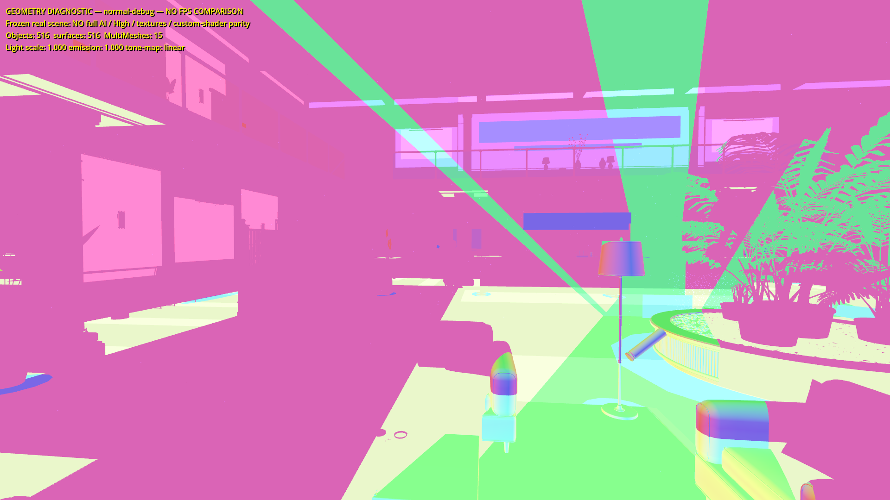

# Godot native migration validation

The bounded Web audio round ended after two opposite-order SAB comparisons.
Full 1% low improved about 12–13% and native node creation fell about 39%, while
mean FPS improved 4.02% and 0.30%. Every run still contained two to four intervals
over 100 ms; the best complete low was 20.66 against the target above 45.
[Stage 11](browser-render-60hz.md#stage-11-bounded-audible-sab-trial-and-godot-pivot)
retains both the real benefit and the limits. The user's conditional exit rule
redirected the next experiment to Godot. The original product core remains
Stage 3; the SAB prototype was not promoted.

## First native import result

The repository now contains a reproducible
[real-scene component project](../../prototypes/godot-render-component/README.md).
The official portable Godot 4.7.2 archive passed its published SHA-512 and valid
Windows signature checks. The executed build reported
`4.7.2.stable.official.ed1daf0bf`, Vulkan 1.4.359, Forward+ and RX 9070 XT.
The binary is kept in the local tool workspace. The
[official download page](https://godotengine.org/download/windows/) describes
the standard portable build; development/editor bytes are not a release-package
measurement.

The original browser ran the real fixed full-AI scenario to tick 240, then paused
at the endFrame boundary. The export retained:

| Captured scene inventory | Count |
|---|---:|
| Objects / geometry resources / materials |516 / 252 / 192|
| Unique vertices / surfaces |5,330,835 / 516|
| Existing instance multiplicity |3,454|
| Enumerated triangles |2,327,336|
| Frozen skinned meshes / lights |11 / 15|

The first monolithic JSON capture exceeded V8's string limit. A bounded stream
then wrote the complete 825,327,988-byte diagnostic snapshot without discarding
scene content. That text expansion is not game-asset, runtime-memory or release
package size. The large snapshot is kept locally with its hash, not committed.

The first native smoke loaded the data but failed validation with 14 MultiMesh
surface-material ownership errors and an almost-white image. Both failures
were retained. MeshInstance and MultiMesh material ownership were corrected.
Two first-person masks that originally wrote neither color nor depth were
mapped to SHADOWS_ONLY using their exact source ownership/flags, retaining their
meshes and original shadow contribution.

The second native smoke passed with no engine errors: all 516 objects and
5,330,835 vertices imported, 3,454 instances across 15 MultiMeshes, 1920×1080,
4× MSAA, a 4096 shadow setting, and 120 recorded native callbacks. Load time in
this development diagnostic was about 9.43 seconds. The normal-debug image
preserved recognizable hotel geometry and camera composition:

This establishes the data/import/render pipeline. It does not establish faster
High rendering. The screenshot intentionally uses diagnostic normals and still
contains unported shader-instanced/alpha behavior. No FPS ranking is made.
The metadata, source hashes and retained failures are in
[stage12-godot-component.json](evidence/stage12-godot-component.json).

The later [Stage15 material path](../../prototypes/godot-render-component/render/README.md)
loads154 same-session supported textures and restores the original High GL
light-shaft discard. Its relocated120-frame Vulkan smoke retains every captured
object and removes the false white diagonal. Shared compile/AO/lightfield,
lighting, postprocessing, remaining custom shaders and reflection still prevent
High parity. [Source and evidence](evidence/stage15-godot-pbr-shaders.json).

## Original logic and audio gates

The current preferred experiment retains original JavaScript gameplay in Node
and replaces rendering/audio ownership with Godot. Existing bundle fixtures can
load real Three math and world classes without WebGL. A real CPU Canvas2D
backend now permits the original world/character factories to execute rather
than supplying fake actors, geometry or text metrics. World initialization has
reproduced 863 colliders, 101 physics props, 124 panes and 119 navigation nodes,
matching the captured browser's initialization statistics. The full original
nine-bot/3,600-tick CPU gate has now passed all eight strict exports and botCalls
in repeated portable runs. Explicit immutable initial homes remove the renderer
UUID/initial-RNG coupling; original construction and physics reset still run.
[Stage 13](browser-render-60hz.md#stage-13-original-node-authoritative-logic-parity)
and the [runnable Node package](../../prototypes/godot-node-logic/README.md)
retain all fields, source guards and initial-data provenance. Real-time pacing,
live IPC/state age and accepted audio/rendering remain separate gates.

The [affine skin component](../../prototypes/godot-skin-component/README.md)
now preserves both original team rest meshes and complete bone palettes. Both
teams pass Godot CPU checks and visible Vulkan palette-readback smokes. These
finite pose samples do not validate continuous live AI, GPU-deformed vertex
readback, skin normals or High shaders; [Stage 14 evidence](evidence/stage14-godot-affine-skin.json)
records those limits.

The audio port retains original cue/RNG/voice/steal semantics upstream. A
correction reduced seven-casing dry PCM residuals to peak 2.67e-6/4.99e-6 at
44.1/48 kHz, still above the native-repeat floor and not byte-exact or listening
acceptance. A local two-process Godot 4.7.2 playback prototype now runs. Its
finite 48 kHz WASAPI test returned all 93 ordered acknowledgements with no
missing, duplicate or refused records, but seven commands missed deadlines
(maximum 512 frames / 10.67 ms) and were rejected, causing missing sound.
The preserved local result is `work/godot-native/audio/live-wasapi-1/result.json`.
A later finite v2 WASAPI run preserved factory-call currentTime semantics and
applied all93 commands on time; cross-run timing variation prevents attributing
all seven improvements to that correction. Full-AI graph capture reconciled
858,445 operations and found80.1% named-source dry projection coverage. The
missing exponential-frequency sine and one-shot PCM paths, full simultaneous
mixing, spatial/bus routing and full-game/device quality remain unaccepted.
Local finite v2 and full-AI evidence are under
`work/godot-native/audio/live-v2/wasapi-1/` and `work/godot-native/audio/full-ai/`.

The [live bridge and native receiver](../../prototypes/godot-live-bridge/README.md)
now preserve all eight complete original-AI exports in real-time tests. One
skin-only Vulkan pair improved source snapshots38.71→55.54Hz and stale engine
draws35.45%→7.70% after only changing timer scheduling. It still does not show
60fresh poses/second or full High parity. The published source passes complete
CPU equality and partial visible native path checks; [Stage16](evidence/stage16-godot-live-bridge.json)
keeps those distinct from the earlier full native experiment and reports state
age, callback timing and memory limits. There is no physical-present/GPU-time
or final-release acceptance.

Migration acceptance still requires the original full AI/perception/navigation,
physics/death/ragdolls/grenades/K9, live geometry and skin updates, full sound,
and the High effects including planar reflection at up to 30 Hz. Recordings of
poses and a fixed native renderer cannot satisfy that workload. Native render
intervals, unique logical pose age, simulation gaps and audio deadlines must all
be reported so a smooth renderer cannot hide stale gameplay.

Godot's SSR has view/transparent-object limitations and is not automatically
equivalent to this game's planar reflection. A mirrored-camera SubViewport
route still needs clipping, receiver masks, blur and recursion checks.
[Godot environment documentation](https://docs.godotengine.org/en/stable/tutorials/3d/environment_and_post_processing.html),
[SubViewport update modes](https://docs.godotengine.org/en/stable/classes/class_subviewport.html).

The performance target remains 1080p High, complete full-AI workload, stable
60 FPS or complete 1% low above 45. Whole-tree memory, true cold/entry timing and
an actual exported release package will be measured once an equivalent slice
exists; the current editor binary, JSON dump and engine memory monitors do not
provide those results.
